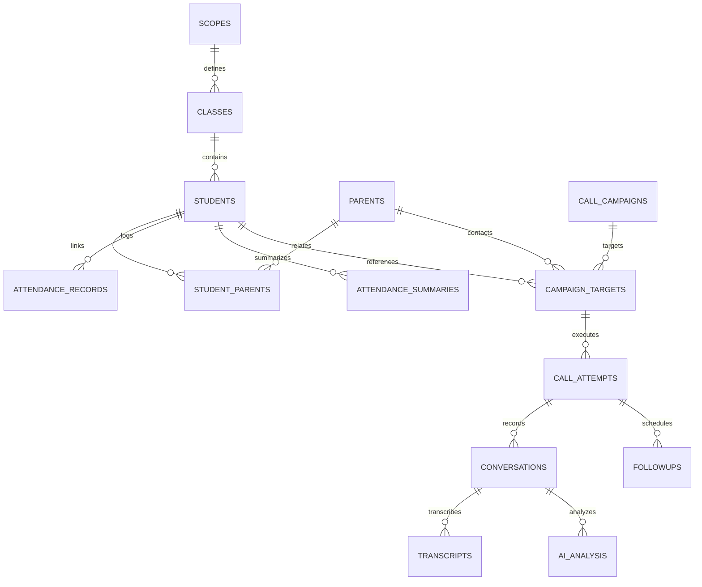

# AttendWise AI 2026 — Autonomous Academic Attendance & Parent Response Management System

AttendWise is an institutional, database-driven college attendance management and automated parent communication system. It automates absence detection from institutional attendance rosters, resolves authorized parent/guardian contact records directly from PostgreSQL, and orchestrates conversational multilingual phone outreach via an isolated AI Voice Agent.

---

## 📑 Table of Contents

1. [Executive Overview & Purpose](#1-executive-overview--purpose)
2. [Actual Technology Stack](#2-actual-technology-stack)
3. [System Architecture](#3-system-architecture)
4. [Repository Folder Structure](#4-repository-folder-structure)
5. [Database Architecture & Entity Relationships](#5-database-architecture--entity-relationships)
6. [Backend Services & REST APIs](#6-backend-services--rest-apis)
7. [Voice Agent Telephony & Real-Time Audio Pipeline](#7-voice-agent-telephony--real-time-audio-pipeline)
8. [Database-Driven Calling Workflow & Consent Model](#8-database-driven-calling-workflow--consent-model)
9. [Frontend Components & User Interface](#9-frontend-components--user-interface)
10. [Environment Variables & Security Configuration](#10-environment-variables--security-configuration)
11. [Local Setup, Execution & Management Scripts](#11-local-setup-execution--management-scripts)
12. [Provider Implementations, Verification Status & Deployment Blockers](#12-provider-implementations-verification-status--deployment-blockers)
13. [Automated Test Suite & Verification Results](#13-automated-test-suite--verification-results)
14. [Viva Voce Questions & Answers](#14-viva-voce-questions--answers)
15. [Professor & Examiner Presentation Guide](#15-professor--examiner-presentation-guide)

---

## 1. Executive Overview & Purpose

Colleges face chronic dropouts and regulatory non-compliance due to delayed parent communication when students miss classes. Manual calling by faculty is labor-intensive, unlogged, and error-prone.

AttendWise solves this through a strictly database-backed pipeline:
1. **Roster Ingestion:** Faculty or administrators import attendance rosters (Excel, CSV, DOCX) or record live daily roll calls.
2. **Deterministic Absence Detection:** Identifies students absent on specific dates or falling below configurable statutory thresholds (e.g., 75%).
3. **Database-Driven Contact Resolution:** Resolves primary guardian contacts, preferred languages, and explicit call authorizations from PostgreSQL.
4. **Autonomous Voice Telephony:** An isolated Python voice agent designed for conversational voice calls in Hindi (`hi-IN`) or Indian English (`en-IN`), with a fully verified offline mock demonstration mode.
5. **AI Analysis & Follow-Up Automation:** Transcripts are classified into structured categories (Medical Reason, Will Attend, Disputed, Bus Delay, Callback Requested), with automated follow-up ticket scheduling.
6. **Institutional Hierarchy:** Complete Role-Based Access Control (RBAC) across Director (`SUPER_ADMIN`), Head of Department (`ADMIN`), and Faculty (`STAFF`).

---

## 2. Actual Technology Stack

### Backend Core
- **Framework:** FastAPI 0.115+ (Python 3.11+)
- **Database ORM:** SQLAlchemy 2.0 (Mapped typed columns)
- **Database Driver:** `psycopg` (Version 3 binary)
- **Migrations:** Alembic 1.14+
- **Security:** Argon2 password hashing, PyJWT HS256 tokens, server-side permission gating
- **File Ingestion:** `openpyxl`, `docx`, `csv`

### Voice Telephony Service (`voice-agent/`)
- **Web Framework:** FastAPI with Bidirectional WebSockets (`/media-stream`)
- **Telephony Provider:** Twilio REST API & TwiML WebSocket Audio Stream (code-complete integration; live outbound carrier calls have not yet been verified with a real authorized phone call)
- **Speech-to-Text (STT):** Deepgram Nova-3 Multilingual streaming websocket (requires live API key and external network access; live API connectivity is not verified with currently blank keys)
- **Dialogue Intelligence:** Groq LLM API (`openai/gpt-oss-20b`) with local rule-based keyword fallback (`_fallback_rule_based`) (requires live API key and external network access; live API connectivity is not verified with currently blank keys)
- **Text-to-Speech (TTS):** Edge TTS (`hi-IN-MadhurNeural`, `en-IN-NeerjaNeural`) streaming from Microsoft online speech cloud endpoints (requires external network access); optional Cartesia Sonic (`mulaw 8000Hz`) cloud fallback (requires `CARTESIA_API_KEY` and external network access)
- **State Store:** PostgreSQL CallStore with idempotency and session replay protection

### Frontend Web Application (`frontend/`)
- **Framework:** React 18, Vite 8
- **Icons:** `lucide-react`
- **Networking:** Custom typed Fetch API client with automatic token refreshing
- **Styling:** Vanilla responsive CSS with dark-theme glassmorphism and mobile optimization

---

## 3. System Architecture

```text
┌─────────────────┐       HTTP / REST       ┌───────────────────────────┐
│  React 18 SPA   │ ──────────────────────> │  AttendWise FastAPI Core  │
│  (Port 5173)    │ <────────────────────── │  (Port 8000)              │
└─────────────────┘                         └─────────────┬─────────────┘
                                                          │
                                     SQLAlchemy ORM (psycopg)
                                                          │
                                                          ▼
                                            ┌───────────────────────────┐
                                            │   PostgreSQL Database     │
                                            │   (Attendance & Contacts) │
                                            └─────────────┬─────────────┘
                                                          ▲
                                     Server-to-Server API │ (Callbacks & Context)
                                                          ▼
                                            ┌───────────────────────────┐
                                            │  Standalone Voice Agent   │
                                            │  (Port 8001)              │
                                            └─────────────┬─────────────┘
                                                          │
                             Twilio Bi-directional WebSocket (/media-stream)
                                                          │
                                                          ▼
                                            ┌───────────────────────────┐
                                            │   Twilio Voice Telephony  │
                                            └─────────────┬─────────────┘
                                                          │
                                      Real-Time Audio     │
                                                          ▼
                                            ┌───────────────────────────┐
                                            │ Deepgram STT (Nova-3)     │
                                            │ Groq LLM (gpt-oss-20b)    │
                                            │ Edge TTS (Madhur Hindi)   │
                                            └───────────────────────────┘
```

---

## 4. Repository Folder Structure

```text
attendance-ai-agent/
├── .github/                      # CI/CD GitHub Actions workflows
├── backend/                      # Main AttendWise FastAPI Core Application
│   ├── app/
│   │   ├── api/v1/routes/        # REST routes (auth, attendance, calls, campaigns, parents, etc.)
│   │   ├── core/                 # Config, security, error handlers, permissions
│   │   ├── db/                   # Database session, base model, auto-seed
│   │   ├── integrations/calling/ # Provider abstraction (MockProvider, VoiceAgentProvider)
│   │   ├── models/               # SQLAlchemy 2.0 ORM models
│   │   ├── schemas/              # Pydantic validation schemas
│   │   └── services/             # Core business logic services
│   ├── migrations/               # Alembic database migration revisions
│   ├── tests/                    # 48 comprehensive automated tests (including 11 E2E flow tests)
│   ├── Dockerfile                # Production container definition
│   ├── pytest.ini                # Pytest configuration with pythonpath=.
│   └── requirements.txt          # Python production dependencies
├── frontend/                     # React 18 + Vite Web Application
│   ├── src/
│   │   ├── api/client.js         # Centralized API network client
│   │   ├── components/           # Shared UI cards, notice banners, status indicators
│   │   ├── features/             # App views (Dashboard, Attendance, Campaigns, Parents, etc.)
│   │   ├── App.jsx               # Navigation router and authenticated shell
│   │   └── index.css             # Responsive styling rules
│   ├── vercel.json               # Vercel SPA routing configuration
│   └── package.json              # NPM dependencies and build scripts
├── voice-agent/                  # Standalone AI Telephony Service
│   ├── app/
│   │   ├── telephony/            # DialogManager, Groq, Deepgram, Edge TTS, CallStore
│   │   └── integrations/         # BackendClient for authenticated webhook callbacks
│   ├── tests/                    # 20 automated tests for telephony, prompt and dialog
│   ├── pytest.ini                # Pytest configuration
│   └── requirements.txt          # Telephony dependencies
├── scripts/                      # Verified PowerShell Operations Scripts
│   ├── setup-local.ps1           # Full 1-click dependency install, DB migration, admin bootstrap
│   ├── start-local.ps1           # Launches Backend (8000), Voice Agent (8001), Frontend (5173)
│   ├── check-local.ps1           # Executes full health check, 68 automated tests (48 backend + 20 voice-agent), frontend build
│   └── stop-local.ps1            # Safely terminates project-managed services using PID and process identity tracking via .run/pids.json (not blind port termination)
└── README.md                     # Master project technical specification
```

---

## 5. Database Architecture & Entity Relationships

The PostgreSQL database acts as the single source of truth. No student or guardian contact is ever hardcoded.



### Critical Database Tables:
- `students`: Stores institutional roll numbers, student codes, class IDs, active statuses.
- `parents`: Stores verified guardian contacts (`primary_phone`, `alternate_phone`), language preferences, and explicit `call_consent` and `call_opt_out` boolean flags.
- `student_parents`: Association table linking students to parents with relationship types (`Father`, `Mother`, `Guardian`) and an `is_primary` flag.
- `attendance_records`: Individual date-wise attendance records (`PRESENT`, `ABSENT`, `LATE`, `EXCUSED`).
- `call_campaigns`: Absence outreach campaigns scoped to dates, classes, and statutory thresholds.
- `campaign_targets`: Database-generated call targets with dynamically snapshot percentage, contact authorization status, and phone numbers.
- `call_attempts`: Physical call dispatches tracking provider call IDs, telephony statuses (`QUEUED`, `RINGING`, `COMPLETED`, `FAILED`), and durations.
- `conversations` & `transcripts`: Full turn-by-turn spoken dialogue with speaker labels, confidence scores, and sequence numbers.
- `ai_analyses`: Groq LLM categorization (`MEDICAL_REASON`, `WILL_ATTEND`, `DISPUTED`, etc.) and sentiment summary.
- `followups`: Administrative action tickets for manual callback or faculty review.

---

## 6. Backend Services & REST APIs

### Key API Endpoints:
| Method | Endpoint | Description | Permission |
|---|---|---|---|
| `POST` | `/api/v1/auth/login` | OAuth2 form login returning JWT access token | Public |
| `GET` | `/api/v1/attendance` | Date-wise attendance query by class & date | `attendance.read` |
| `POST` | `/api/v1/attendance/import` | Ingest attendance rosters (XLSX, CSV, DOCX) | `attendance.import` |
| `GET` | `/api/v1/parents` | List parents with contact details and consent status | `student.read` |
| `POST` | `/api/v1/parents` | Register new guardian record in database | `student.create` |
| `PATCH` | `/api/v1/parents/{id}` | Update phone number, preferred language, or consent | `student.manage` |
| `POST` | `/api/v1/campaigns` | Create campaign from absent students | `campaign.create` |
| `POST` | `/api/v1/campaigns/{id}/dispatch-next` | Dispatch next eligible, authorized call target | `campaign.manage` |
| `POST` | `/api/v1/calls/attempts/{id}/dispatch` | Dispatch call attempt to active provider | `campaign.manage` |
| `POST` | `/api/v1/calls/callback` | Authenticated webhook callback from voice agent | `X-API-Key` |
| `POST` | `/api/v1/calls/simulate-response` | Mock simulation using synthetic dialogue and transcripts marked `is_demo=True` | `campaign.manage` |
| `GET` | `/api/v1/followups` | Review and update scheduled follow-up tickets | `followup.read` |

---

## 7. Voice Agent Telephony & Real-Time Audio Pipeline

The voice agent is an isolated microservice operating on port 8001:

1. **Call Origination:** Receives an authenticated dispatch request from the backend containing structured context (student name, guardian name, attendance percentage, date).
2. **Twilio REST Dispatch:** Designed to place outbound calls via Twilio REST API pointing to the `/twiml/{session_id}` endpoint (code-verified integration; actual live outbound carrier calls have not yet been placed or verified with a real authorized phone call).
3. **Bi-directional WebSocket Stream:** Upon answer, Twilio connects to `/media-stream`, streaming raw μ-law 8000Hz audio frames.
4. **Speech Recognition (STT):** Deepgram Nova-3 processes continuous inbound audio frames into transcribed text events over a cloud WebSocket (requires active external internet access and `DEEPGRAM_API_KEY`; connectivity is not verified with default blank keys).
5. **Conversational Turn Management:** `DialogManager` governs state progression:
   - Initial greeting in Hindi / English with institutional affiliation.
   - Absence notification with student's current attendance percentage.
   - Inquiry regarding reason for absence.
   - Cooperative handling of interruption and clarification.
   - Generates contextual responses via Groq LLM API (`openai/gpt-oss-20b`) or local fallback rule-based classifier. Groq requires external internet access and `GROQ_API_KEY` (connectivity unverified with blank keys).
6. **Speech Synthesis (TTS):** Edge TTS generates Hindi/English audio chunks streamed from Microsoft online speech cloud endpoints (requires external internet access); optional Cartesia Sonic WebSocket client provides alternative speech synthesis (`mulaw 8000Hz`, requires `CARTESIA_API_KEY` and external network access). Neither TTS provider operates offline.
7. **Post-Call Analysis & Callback:** Once the call terminates, `ResponseAnalyzer` extracts reason categories (via Groq API or rule-based fallback) and invokes the backend webhook callback `/api/v1/calls/callback` with API key authentication.
8. **Demonstration & Testing Mode:** In default and local evaluation environments, the system utilizes the fully verified `MockCallingProvider`, where calls are simulated with deterministic synthetic dialogue and resulting records/transcripts are explicitly stamped with `is_demo=True`.

---

## 8. Database-Driven Calling Workflow & Consent Model

### The Strict Non-Hardcoded Workflow:
```text
Admin creates/imports student
  │
  ▼
Admin registers parent/guardian in PostgreSQL (call_consent=False, call_opt_out=False)
  │
  ▼
Parent linked to student as primary contact (StudentParent, is_primary=True)
  │
  ▼
Guardian explicitly grants affirmative calling permission (call_consent=True)
  │
  ▼
Faculty imports attendance roster or marks roll call (student marked ABSENT)
  │
  ▼
Backend evaluates 11-step eligibility gate (consent, opt-out, phone normalization, duplicate check)
  │
  ▼
CampaignTarget created with database IDs, normalized E.164 phone, and contact_authorized=True
  │
  ▼
CallAttempt created in QUEUED status under an explicitly initiated campaign (RUNNING)
  │
  ▼
Backend re-validates all 11 eligibility constraints immediately prior to dispatch
  │
  ▼
Provider initiates call with validated database context (Mock or Voice Agent)
  │
  ▼
Transcripts, AI Analysis, and Follow-ups saved to PostgreSQL source of truth
```

### Fail-Closed Guardian Consent & Authorization Model

AttendWise enforces strict regulatory compliance and fail-closed privacy:
- **`call_consent = False` (Default):** Consent has not been granted. A missing consent record is NEVER interpreted as permission to call.
- **`call_opt_out = False` (Default):** No opt-out has been recorded. Absence of an opt-out is NEVER confused with consent.
- **`contact_authorized = False` (Default):** The target has not yet passed full backend verification.

Alembic migration `c1e5a2b3d4f5_consent_fails_closed` changed database server defaults to `false` and reset all previously unverified consent values to `false` (`call_consent = false`) because no trustworthy historical consent audit records were available.

> [!IMPORTANT]
> **Documented Affirmative Consent Requirement:**
> A guardian's affirmative consent must be genuinely documented (e.g., through signed physical admission/registration forms, written consent slips, or verifiable institutional records). An administrative UI toggle in `ParentsPage` modifies the database record for operational management, but an admin UI toggle alone must NOT be described as legal proof of guardian consent.

### 11 Mandatory Call Eligibility Checks
Before any call is queued or dispatched, the backend enforces 11 server-side verification gates:
1. **Student Exists & Active:** Student record is active and enrolled in an active class.
2. **Guardian Exists & Active:** Guardian parent record exists in PostgreSQL and is active.
3. **Database Relationship Verified:** Guardian is linked to the student via `StudentParent`.
4. **Primary Contact Verified:** Guardian is designated as the student's primary contact (`is_primary = true`).
5. **Phone Number Normalized & Valid:** Phone number is in valid E.164 international format (`^\+[1-9]\d{7,14}$`).
6. **Explicit Consent Granted:** `parent.call_consent` is explicitly `True`.
7. **No Opt-Out Recorded:** `parent.call_opt_out` is strictly `False`.
8. **Target Authorization Established:** `target.contact_authorized` has been validated by backend logic.
9. **Valid Absence Record:** A valid `AttendanceRecord` with status `ABSENT` exists for the campaign date.
10. **Duplicate Notification Prevented:** Guardian has not already received a `COMPLETED` notification for this absence date.
11. **Campaign Explicitly Initiated:** Admin has explicitly started the campaign (`status = RUNNING`).

Critical eligibility validation is repeated at dispatch time to prevent stale or manipulated targets from bypassing checks. If consent is revoked between queueing and dispatch, the attempt and target are cancelled immediately.

---

## 9. Frontend Components & User Interface

The React frontend offers a responsive, high-contrast, institutional dashboard:
- **`DashboardPage.jsx`:** High-level metrics, active campaigns, daily absence trends, and recent call logs.
- **`AttendanceTerminal.jsx`:** Real-time roll-call terminal allowing faculty to mark Present/Absent/Late with instant visual feedback.
- **`CampaignPage.jsx`:** Campaign configuration wizard with date selection, class filters, and attendance threshold sliders.
- **`CallOperationsPage.jsx`:** Real-time call operations cockpit displaying active call targets, call statuses, live simulation options, and turn-by-turn transcripts.
- **`ParentsPage.jsx`:** Database-backed directory of parent and guardian contacts, with phone number editing, guardian registration, and administrative consent status toggling (note: this toggle manages the database authorization state, but affirmative guardian consent must be documented through institutional records).
- **`StudentsPage.jsx`:** Comprehensive student directory displaying student IDs, roll numbers, classes, emails, and linked primary guardian contacts.
- **`FollowupsPage.jsx`:** Action board for pending administrative callbacks with status management (`PENDING`, `COMPLETED`, `CANCELLED`).
- **`MLRiskPage.jsx`:** Advisory attendance risk dashboard based on deterministic heuristic rule-based indicators (`rule-based-v1`: attendance percentage drops, absence streaks, and urgency thresholds). Note: This uses explicit heuristics and rule-based tiers; it does NOT claim trained machine learning models or statistical predictive accuracy.

---

## 10. Environment Variables & Security Configuration

### Internal Telephony Authentication
The backend and voice-agent services communicate via a shared server-to-server secret (`VOICE_AGENT_API_KEY` on the backend, `CALL_API_KEY` on the voice agent).
- **Fail-Closed Secret Enforcement:** If the secret is not configured, both services reject calls with HTTP 503 Service Unavailable.
- **Constant-Time Comparison:** Key verification uses `hmac.compare_digest` to prevent timing attacks.
- **Automated Generation:** `.\scripts\setup-local.ps1` automatically generates cryptographically strong 32-byte random hex keys for new environments without overwriting existing working credentials.

### Backend Configuration (`backend/.env`):
```env
APP_NAME=AttendWise AI
ENVIRONMENT=development
DATABASE_URL=postgresql+psycopg://<DB_USER>:<SECURE_LOCAL_PASSWORD>@localhost:5432/<DB_NAME>
JWT_SECRET_KEY=<generated-cryptographic-secret-32-chars-minimum>
JWT_ALGORITHM=HS256
ACCESS_TOKEN_EXPIRE_MINUTES=60
CORS_ALLOWED_ORIGINS=http://localhost:5173,http://127.0.0.1:5173

# Telephony Safety Gate (Keep false for mock testing)
REAL_CALLS_ENABLED=false
EXTERNAL_AI_PROCESSING_APPROVED=false
VOICE_AGENT_BASE_URL=http://127.0.0.1:8001
VOICE_AGENT_API_KEY=<synchronized-internal-telephony-secret>
CALLING_PROVIDER=mock
```

### Voice Agent Configuration (`voice-agent/.env`):
```env
BACKEND_BASE_URL=http://127.0.0.1:8000
REAL_CALLS_ENABLED=false
EXTERNAL_AI_PROCESSING_APPROVED=false
PUBLIC_BASE_URL=https://your-domain.ngrok-free.app
CALL_API_KEY=<synchronized-internal-telephony-secret>
DATABASE_URL=postgresql://<DB_USER>:<SECURE_LOCAL_PASSWORD>@localhost:5432/<DB_NAME>

TWILIO_ACCOUNT_SID=
TWILIO_AUTH_TOKEN=
TWILIO_FROM_NUMBER=

DEEPGRAM_API_KEY=
DEEPGRAM_MODEL=nova-3
DEEPGRAM_LANGUAGE=multi

GROQ_API_KEY=
GROQ_MODEL=openai/gpt-oss-20b

# Speech Synthesis: edge (default cloud endpoint), cartesia (optional cloud provider), or deepgram
TTS_PROVIDER=edge
EDGE_VOICE_HI=hi-IN-MadhurNeural
EDGE_VOICE_EN=en-IN-NeerjaNeural

# Optional Cartesia TTS Configuration (supported when TTS_PROVIDER=cartesia)
CARTESIA_API_KEY=
CARTESIA_MODEL=sonic-3.6
CARTESIA_VOICE_ID=
CARTESIA_VERSION=2026-08-14
```

> [!TIP]
> **Secure Local PostgreSQL Setup Instructions:**
> Never use weak or default illustrative credentials like `postgres:postgres` in any environment. To configure a dedicated, secure local database user:
> 1. Launch `psql` as a PostgreSQL administrator:
>    ```sql
>    CREATE USER attendwise_user WITH ENCRYPTED PASSWORD '<SECURE_LOCAL_PASSWORD>';
>    CREATE DATABASE attendance_ai_agent OWNER attendwise_user;
>    GRANT ALL PRIVILEGES ON DATABASE attendance_ai_agent TO attendwise_user;
>    ```
> 2. Set `DATABASE_URL` in `backend/.env`:
>    `postgresql+psycopg://attendwise_user:<SECURE_LOCAL_PASSWORD>@localhost:5432/attendance_ai_agent`
> 3. Set `DATABASE_URL` in `voice-agent/.env`:
>    `postgresql://attendwise_user:<SECURE_LOCAL_PASSWORD>@localhost:5432/attendance_ai_agent`
> 4. Verify connectivity using `.\scripts\check-local.ps1`.

### Frontend Configuration (`frontend/.env`):
```env
VITE_API_BASE_URL=/api/v1
```

---

## 11. Local Setup, Execution & Management Scripts

The repository includes four verified PowerShell scripts located in `scripts/`:

### 1. Setup Local Environment
Installs all dependencies, applies database migrations, and bootstraps initial admin:
```powershell
.\scripts\setup-local.ps1
```

### 2. Start All Local Services
Starts Backend (8000), Voice Agent (8001), and Frontend (5173) with health polling:
```powershell
.\scripts\start-local.ps1
```

### 3. Comprehensive Local Health & Test Audit
Verifies PostgreSQL connection, Alembic migrations, executes all 68 automated tests (48 backend + 20 voice agent), and verifies frontend build:
```powershell
.\scripts\check-local.ps1
```

### 4. Stop All Local Services Safely
Gracefully terminates ONLY project-managed processes recorded in `.run\pids.json` by `start-local.ps1`:
```powershell
.\scripts\stop-local.ps1
```
- **Process Ownership Shield:** Verifies process PID, runner identity (`powershell`, `pwsh`, `python`, `node`, `cmd`), command-line script markers (`start_backend.ps1`, `start_voice.ps1`, `start_frontend.ps1`), and project root path.
- **Port Collision Safety:** Never blindly kills listening ports (8000, 8001, 5173). Unrelated applications running on those ports remain completely untouched.
- **Child Process Handling:** Discovers and terminates child worker processes (Uvicorn, Vite) before stopping parent wrappers.
- **Stale Tracking Cleanup:** Safely cleans up stale process records and handles repeated stop runs without errors.

### Manual Individual Commands (Cross-Platform / Linux / Mac):
- **Backend:**
  ```bash
  cd backend
  source .venv/bin/activate
  alembic upgrade head
  uvicorn app.main:app --host 127.0.0.1 --port 8000 --reload
  ```
- **Voice Agent:**
  ```bash
  cd voice-agent
  source .venv/bin/activate
  uvicorn app.telephony.server:app --host 127.0.0.1 --port 8001 --reload
  ```
- **Frontend:**
  ```bash
  cd frontend
  npm install
  npm run dev
  ```

---

## 12. Provider Implementations, Verification Status & Deployment Blockers

### Actual Provider Implementations & Verification Status

| Subsystem | Implemented Logic | Verification & Testing Status | Network & Credential Requirements |
| :--- | :--- | :--- | :--- |
| **Mock Calling** | Fully local, multi-turn parameterized Hindi/Hinglish dialog with BBS College persona, medical/transit/leave/callback presets, synthetic transcripts stamped with `is_demo=True`. | **Fully Tested & Verified** | Runs 100% locally with **zero external network dependencies** and no external API keys. Default demonstration mode. |
| **Twilio Voice** | Twilio REST client creates outbound calls (`calls.create`); `/twiml` serves secure media stream WebSocket; `/events` receives status webhooks with HMAC-SHA1 validation. | **Code-Verified Only** (Unit/mock tests pass; **actual outbound calls have NOT yet been verified with a real authorized phone call**) | Requires active Twilio account credentials (`TWILIO_ACCOUNT_SID`, `TWILIO_AUTH_TOKEN`, `TWILIO_FROM_NUMBER`), public HTTPS tunnel (`PUBLIC_BASE_URL`), and external network access. Telephony server fails closed (`503 Service Unavailable`) if credentials are blank. |
| **Groq AI** | HTTP client to `/chat/completions` for guardian check, conversational attendance dialog, and structured transcript analysis. | **Code-Verified Only** (Unit tests pass; **live API connectivity is NOT verified with currently blank keys**) | Requires `GROQ_API_KEY` and **external network access** (does NOT operate offline). When keys are absent, falls back to local rule-based keyword classifier (`_fallback_rule_based`). |
| **Deepgram STT** | WebSocket client (`wss://api.deepgram.com/v1/listen`) consuming incoming 8000Hz μ-law Twilio audio with Nova-3 Hindi/multilingual model. | **Code-Verified Only** (Unit tests pass; **live API connectivity is NOT verified with currently blank keys**) | Requires `DEEPGRAM_API_KEY` and **external network access** (does NOT operate offline). Telephony server fails closed (`503 Service Unavailable`) if key is absent. |
| **Edge TTS & Cartesia** | Edge TTS generates speech chunks resampled to μ-law 8000Hz via `av` container; Cartesia Sonic HTTP/WebSocket client provides alternative speech synthesis. | **Code-Verified Only** (Unit tests pass; Cartesia live API connectivity unverified) | **Requires external network access**; Edge TTS communicates with Microsoft online speech cloud endpoints (does NOT run offline, though requires no paid key). Cartesia requires `CARTESIA_API_KEY` and external network access. |

### Distinction: Code-Verified vs. Live-Provider-Tested
- **Code-Verified Integrations:** The Twilio, Groq, Deepgram, Edge TTS, and Cartesia adapters are implemented, type-checked, and validated with unit test suites (e.g. schema serialization, HMAC signature verification, prompt generation, error handling).
- **Live-Provider Testing Status:** Live external provider connectivity has **NOT** been validated against active third-party cloud services because live API keys are left blank in default configuration, and actual outbound carrier calls have **NOT** been verified with a real authorized phone call.
- **External Network Dependencies:** Contrary to common misconceptions, Edge TTS, Groq, Deepgram, and Cartesia all require outbound internet connectivity to communicate with remote cloud endpoints. They do not operate without external network access.
- **Mock Calls & Synthetic Dialogues:** Only the Mock Calling provider operates completely offline with zero external network access. It generates synthetic multi-turn conversations (covering medical excuses, transit delays, casual leave, dispute cases, and callbacks) and explicitly stamps every generated attempt, transcript, and audit record with `is_demo=True`.

### Deployment Blockers for Live Telephony
Before switching `REAL_CALLS_ENABLED=true` in production:
1. **Twilio Account Provisioning:** Active Twilio account with Account SID, Auth Token, and an E.164 caller ID number (`TWILIO_FROM_NUMBER`).
2. **Public HTTPS Webhook URL:** Twilio requires a public HTTPS base URL (`PUBLIC_BASE_URL`) with valid SSL for TwiML and WebSocket media streams.
3. **External AI Credentials:** Valid API keys for Groq (`GROQ_API_KEY`) and Deepgram (`DEEPGRAM_API_KEY`).
4. **Institutional Consent Audit:** Verification that all contacted guardians have provided documented affirmative consent in `parents.call_consent` (an administrative UI toggle alone does not satisfy legal audit proof).

---

## 13. Automated Test Suite & Verification Results

The AttendWise repository is validated by **68 comprehensive automated tests** across Backend, Voice Agent, and Process Safety:

### Backend Test Suite (48 Tests Passed):
- `tests/test_end_to_end_flow.py` (11 Tests):
  - `test_full_database_driven_calling_lifecycle`: Student -> Parent -> Attendance -> Campaign -> Dispatch -> Simulation -> Transcript -> Followup -> DB verification.
  - `test_unconsented_guardian_cannot_receive_call`: Fails closed when `call_consent=False`.
  - `test_opted_out_guardian_is_always_skipped`: Opted-out guardian is strictly skipped with status `SKIPPED`.
  - `test_missing_phone_number_is_skipped`: Missing phone fails closed with `MISSING_PHONE`.
  - `test_invalid_phone_number_is_skipped`: Non-E.164 phone fails closed with `INVALID_PHONE`.
  - `test_unlinked_guardian_is_rejected`: Student with no `StudentParent` link cannot be called.
  - `test_missing_absence_record_is_rejected`: Target cancelled if student is no longer marked absent.
  - `test_duplicate_notification_is_prevented`: Rejects duplicate calls if already completed on the same date.
  - `test_unauthorized_user_cannot_initiate_campaign`: Role-based boundary blocks non-admin users (HTTP 403).
  - `test_authorization_rechecked_before_dispatch`: Revoked consent between queueing and dispatch cancels attempt.
  - `test_existing_records_with_unknown_consent_fail_closed`: Database and model defaults fail closed.
- `tests/test_calling_workflow.py` (9 Tests):
  - Mock provider ringing status, safety failsafe gates, E.164 phone requirement, internal telephony key absence fail-closed, webhook callback authentication fail-closed, invalid API key rejection, factory defaults, webhook completion persistence, Hindi dialogue simulation.
- `tests/test_stop_local_safety.py` (5 Tests):
  - Project-owned process termination, unrelated process preservation, mismatched/reused PID shield, stale tracking record handling, repeated execution idempotency.
- `tests/test_attendance_excel_parser.py` (5 Tests): Excel roster ingestion, header matching, duplicate prevention.
- `tests/test_attendance_file_parser.py` (3 Tests): CSV and DOCX table parsing, extension validation.
- `tests/test_student_import_service.py` (2 Tests): Bulk student and guardian ingestion with primary contact resolution.
- `tests/test_security_settings.py` (5 Tests): CORS origin validation, password strength, demo-seeding production restrictions.
- `tests/test_error_handlers.py`, `tests/test_health.py`, `tests/test_leave.py`, `tests/test_rule_engine.py` (8 Tests): Health endpoints, exception payloads, leave transitions, callback rules.

### Voice Agent Test Suite (20 Tests Passed):
- `tests/test_telephony.py`: E.164 validation, parent contact authorization, Twilio HMAC-SHA1 signature verification, secure TwiML generation, Deepgram streaming, Groq dialog turns, rural prompts, wrong-number dialog flow, and response analyzer rule-based fallback.
- `tests/test_backend_client.py`: Authenticated backend callback synchronization.
- `tests/test_call_context.py`: Call context schema validation, script drafting, prompt injection protection.
- `tests/test_main.py`: Telephony server initialization.

### Verification Summary:
```text
==========================================================
       AUDIT SUMMARY: 6 PASSED, 0 FAILED      
==========================================================
  [PASS] PostgreSQL Database Connection (Local instance)
  [PASS] Alembic Schema Migrations (Revision: c1e5a2b3d4f5 HEAD)
  [PASS] Backend Pytest Suite (48 tests passed)
  [PASS] Voice-Agent Pytest Suite (20 tests passed)
  [PASS] Frontend ESLint Verification (Zero errors)
  [PASS] Frontend Production Build (Vite bundle compiled cleanly)
==========================================================
```

---

## 14. Viva Voce Questions & Answers

### Q1: What makes AttendWise database-driven rather than hardcoded?
**Answer:** AttendWise never hardcodes student names, roll numbers, or parent contact details in source files. Every call campaign dynamically queries PostgreSQL for students marked absent on a specific date, fetches their primary authorized guardian from `student_parents` and `parents` tables, validates explicit consent, and snapshots that dynamic context into `campaign_targets`.

### Q2: How does the AI Voice Agent handle real-time conversational telephony?
**Answer:** The voice agent is architected for streaming telephony: when Twilio establishes an outbound call, it opens a bi-directional WebSocket connection (`/media-stream`). Inbound audio frames (μ-law 8000Hz) stream to Deepgram Nova-3 over a cloud WebSocket for speech recognition. The transcribed text is processed by a Groq LLM instance (with a local rule-based fallback keyword classifier) to generate concise conversational Hindi/English responses, which Edge TTS (streaming from Microsoft online speech cloud endpoints) or Cartesia converts to μ-law audio frames sent back through the WebSocket. Note that sub-300ms latency is not claimed without empirical network benchmarking; live external provider connectivity has not been verified with active credentials, and actual outbound carrier calls have not yet been placed. For local development and demonstration, the fully verified Mock Calling Provider simulates the conversation using synthetic dialogues marked `is_demo=True`.

### Q3: How is parent privacy and call authorization enforced?
**Answer:** The `parents` table enforces fail-closed privacy through explicit `call_consent` and `call_opt_out` boolean flags. Following Alembic migration `c1e5a2b3d4f5_consent_fails_closed`, all previously unverified consent values were reset to `false` because no trustworthy historical consent audit records were available. If a guardian does not have documented affirmative consent (`call_consent=False`) or has opted out (`call_opt_out=True`), `contact_authorized` evaluates to `False`, and call dispatch is blocked with HTTP 409 Conflict across 11 verification gates. An administrative UI toggle in `ParentsPage` updates the database record for operational control, but affirmative guardian consent must be genuinely documented through institutional records (e.g. signed admission forms or written consent slips) rather than inferred from an admin UI switch alone. Furthermore, live telephony is gated behind `REAL_CALLS_ENABLED=true` and `EXTERNAL_AI_PROCESSING_APPROVED=true`.

### Q4: How are call outcomes persisted and analyzed?
**Answer:** Upon call completion, the voice agent posts a webhook callback payload to the backend containing duration, turn-by-turn transcripts with confidence scores, and AI analysis. The backend saves these into `conversations`, `transcripts`, and `ai_analyses` tables, updates the campaign target status to `COMPLETED`, and automatically generates a `followups` task if further administrative action is needed.

### Q5: How is multi-tenant institutional hierarchy maintained?
**Answer:** AttendWise implements hierarchical scopes (`college`, `department`) linked to `ClassModel`. Users with the `ADMIN` (HOD) role are restricted to their assigned department scope, while `STAFF` users only see assigned classes. `SUPER_ADMIN` (Director) has global access.

---

## 15. Professor & Examiner Presentation Guide

When demonstrating AttendWise to evaluation committees or professors, follow this structured walkthrough:

1. **Architecture & Safety First:** Emphasize that live calls fail closed (`REAL_CALLS_ENABLED=false`) and run in high-fidelity mock simulation mode during demos to prevent unsolicited calls.
2. **Student & Guardian Directory:** Show `StudentsPage` and `ParentsPage`. Demonstrate editing a guardian's phone number and toggling their call authorization status in the management UI (clarifying that affirmative consent must be documented via institutional records and that the toggle updates the operational database flag).
3. **Daily Roll Call:** Navigate to `AttendanceTerminal`. Mark a student `ABSENT`.
4. **Campaign Creation:** Go to `CampaignPage`. Select today's date. Notice how the system automatically identifies the absent student from PostgreSQL and populates the campaign targets.
5. **Call Operations & Simulation:** Open `CallOperationsPage`. Dispatch the call in demonstration mode. Explain that mock calls execute deterministic synthetic Hindi/Hinglish dialogues (e.g., parent stating medical illness or transit delay) and save complete transcripts explicitly marked with `is_demo=True`.
6. **Transcript & Follow-up Audit:** Show the generated turn-by-turn conversation transcript, the AI/rule-based classification, and the automatically generated follow-up ticket in `FollowupsPage`.
7. **Code Quality & Testing:** Execute `.\scripts\check-local.ps1` in the terminal to demonstrate that all 68 automated tests (48 backend + 20 voice-agent) pass and the production build compiles with zero errors.

---

**Developed for Academic Excellence & Real-World College Administration.**
